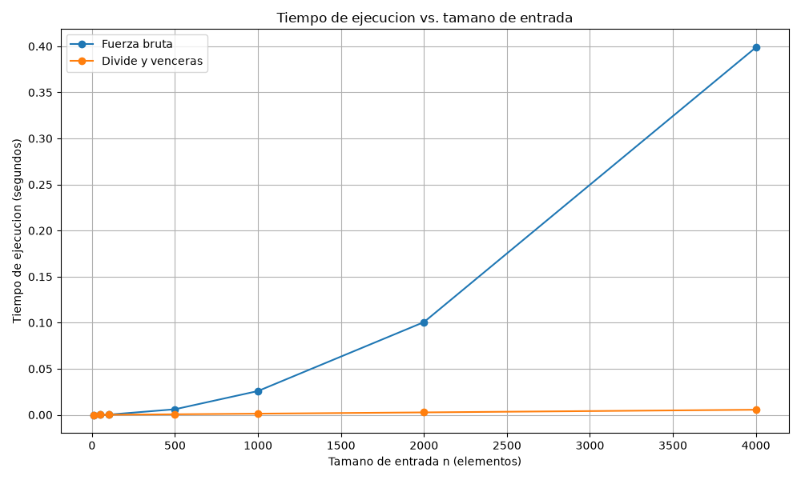

# Laboratorio 2 — Divide y vencerás

**Estudiante:** Alan Arias Ruiz

## Reproducción del experimento

Este laboratorio fue desarrollado en Python. Para reproducir las pruebas y las mediciones se debe utilizar el entorno virtual ubicado en la raíz del repositorio.

### Crear el entorno virtual

Si el entorno virtual todavía no existe, desde la raíz del repositorio se puede crear con:

#### Windows PowerShell

```powershell
python -m venv .venv
.\.venv\Scripts\Activate.ps1
pip install -r requirements.txt
```

#### Linux/macOS

```bash
python3 -m venv .venv
source .venv/bin/activate
pip install -r requirements.txt
```

Si el entorno virtual ya existe, solamente es necesario activarlo.

En Windows:

```powershell
.\.venv\Scripts\Activate.ps1
```

En Linux/macOS:

```bash
source .venv/bin/activate
```

Después se debe ingresar a la carpeta del laboratorio:

```bash
cd lab2-divide-y-vencer
```

### Ejecutar las pruebas

```bash
python pruebas.py
```

Si todas las pruebas son correctas, el programa muestra:

```text
Todas las pruebas fueron superadas correctamente.
```

### Ejecutar el experimento

```bash
python medicion.py
```

Este programa realiza las mediciones y genera la gráfica:

`graficas/tiempo_vs_n.png`

---

# Parte 1 — Implementación y verificación

**Código:** [subarreglo.py](subarreglo.py) | [pruebas.py](pruebas.py)

Se implementaron dos soluciones para encontrar el subarreglo de suma máxima. La primera utiliza fuerza bruta y prueba los diferentes puntos de inicio y fin, acumulando progresivamente la suma. La segunda utiliza divide y vencerás, separando el problema en los casos izquierdo, derecho y cruzado.

Para verificar las implementaciones se probaron los casos solicitados en el laboratorio: la serie de ocho días del enunciado, una lista con un solo elemento, una lista con todos sus valores negativos, otra con todos sus valores positivos y un caso donde el mejor subarreglo cruza el punto medio.

También se generaron veinte listas aleatorias utilizando una semilla fija. Para cada una se comparó la suma máxima obtenida por fuerza bruta con la obtenida mediante divide y vencerás.

Al ejecutar `pruebas.py`, todas las pruebas fueron superadas correctamente.

---

# Parte 2 — Medición y gráfica

**Código:** [medicion.py](medicion.py)

Para realizar el experimento se utilizaron los tamaños `10`, `50`, `100`, `500`, `1000`, `2000` y `4000`. Los valores de cada lista fueron números enteros entre -100 y 100 generados con una semilla fija para hacer reproducible el experimento.

Para cada tamaño se utilizó exactamente la misma lista con ambos algoritmos. Cada medición se realizó tres veces y se tomó la mediana de los tiempos obtenidos para reducir el efecto de pequeñas variaciones del sistema.

El tiempo fue medido utilizando `time.perf_counter()` y solamente se cronometró la ejecución del algoritmo, sin incluir la generación de los datos. Además, durante cada experimento se verificó que ambos algoritmos produjeran la misma suma máxima.

## Resultados

| Tamaño n | Fuerza bruta (s) | Divide y vencerás (s) |
|---:|---:|---:|
| 10 | 0.000005 | 0.000009 |
| 50 | 0.000064 | 0.000048 |
| 100 | 0.000225 | 0.000101 |
| 500 | 0.006047 | 0.000594 |
| 1000 | 0.025840 | 0.001259 |
| 2000 | 0.100641 | 0.002648 |
| 4000 | 0.398776 | 0.005531 |

## Gráfica de tiempo de ejecución



En la gráfica se observa que para los tamaños pequeños las dos curvas se encuentran muy próximas debido a que ambos algoritmos requieren muy poco tiempo. A medida que aumenta el tamaño de entrada, la curva de fuerza bruta crece mucho más rápidamente, mientras que la de divide y vencerás permanece cerca del eje horizontal en esta escala.

---

# Parte 3 — Análisis

## 1. Recurrencia

El algoritmo de divide y vencerás separa el problema en dos subproblemas de tamaño aproximado `n/2`: encontrar el mejor subarreglo de la mitad izquierda y de la mitad derecha. Esto produce `2T(n/2)`. También se debe calcular el mejor subarreglo que cruza el punto medio mediante un recorrido lineal, con costo `Θ(n)`. Por lo tanto, la recurrencia es:

`T(n) = 2T(n/2) + Θ(n)`

Aplicando el método maestro, `a = 2`, `b = 2` y `f(n) = Θ(n)`. Se obtiene:

`n^(log_b(a)) = n^(log_2(2)) = n`

Como `f(n) = Θ(n)` tiene el mismo orden, corresponde al caso 2 del método maestro y la solución es `Θ(n log n)`.

En fuerza bruta, para cada posible posición inicial se recorren las posiciones finales restantes. El número de iteraciones se comporta como `n + (n-1) + ... + 1`, cuya suma es cuadrática. Por esto su complejidad es `Θ(n²)`.

## 2. Lo medido contra lo esperado

La gráfica muestra que fuerza bruta aumenta mucho más rápidamente que divide y vencerás. Tomando los tamaños `2000` y `4000`, donde `n` se duplica, fuerza bruta pasó de `0.100641 s` a `0.398776 s`. El factor de crecimiento fue:

`0.398776 / 0.100641 ≈ 3.96`

El tiempo aumentó aproximadamente 3.96 veces, muy cerca del factor 4 esperado para un algoritmo `Θ(n²)` cuando se duplica el tamaño.

Divide y vencerás pasó de `0.002648 s` a `0.005531 s`:

`0.005531 / 0.002648 ≈ 2.09`

Su tiempo aumentó aproximadamente 2.09 veces. Esto es coherente con `Θ(n log n)`, donde al duplicar la entrada el crecimiento esperado es ligeramente superior al doble.

## 3. Tamaños pequeños

Con `n = 10`, fuerza bruta fue más rápida: `0.000005 s` frente a `0.000009 s`. Sin embargo, con `n = 50`, divide y vencerás ya fue más rápido: `0.000048 s` frente a `0.000064 s`.

Por lo tanto, con los tamaños medidos se puede afirmar que la ventaja de divide y vencerás aparece entre 10 y 50 elementos, aunque no se puede determinar el punto exacto sin realizar mediciones intermedias.

En tamaños muy pequeños, el costo adicional de las llamadas recursivas y del cálculo del caso cruzado puede hacer que la mejor complejidad asintótica todavía no represente una ventaja práctica. Cuando `n` aumenta, la diferencia entre `n²` y `n log n` termina dominando esos costos adicionales.

## 4. ¿Cuándo conviene dividir?

Para hallar solamente el máximo de un arreglo no se obtiene la misma mejora. La solución directa recorre los `n` elementos una sola vez y tiene complejidad `Θ(n)`.

Si se utiliza divide y vencerás, se resuelven dos problemas de tamaño `n/2` y después solamente se comparan los máximos obtenidos, lo cual cuesta `Θ(1)`. La recurrencia sería:

`T(n) = 2T(n/2) + Θ(1)`

Esta recurrencia también produce `Θ(n)`. Por lo tanto, dividir el problema no mejora su orden de crecimiento y además agrega el costo de las llamadas recursivas. En este caso resulta más conveniente realizar un recorrido directo.

## 5. Concepto para la gerente

Recomendaría utilizar divide y vencerás, especialmente si se van a procesar las series de sensores con grandes cantidades de registros. En la medición de `4000` elementos, fuerza bruta tardó `0.398776 s`, mientras que divide y vencerás tardó solamente `0.005531 s`.

Para estimar el comportamiento con `1.000.000` de registros se debe tener en cuenta la complejidad de cada algoritmo y no utilizar una regla de tres lineal.

Pasar de `4000` a `1.000.000` multiplica el tamaño por `250`. En fuerza bruta, cuyo crecimiento es `Θ(n²)`, la estimación es:

`0.398776 × 250² ≈ 24 923.5 segundos`

Esto corresponde aproximadamente a **6.9 horas**.

Para divide y vencerás se utiliza el crecimiento `Θ(n log n)`. Tomando `4000` como referencia:

`0.005531 × (1.000.000 × log2(1.000.000)) / (4000 × log2(4000)) ≈ 2.30 segundos`

Por lo tanto, se estima que divide y vencerás tardaría alrededor de **2.3 segundos** para un millón de registros.

Estas cifras son una **estimación basada en las mediciones realizadas y en el crecimiento teórico de los algoritmos**, no tiempos medidos directamente para un millón de elementos. Los resultados muestran que, a medida que aumenta el volumen de datos, divide y vencerás resulta considerablemente más apropiado que fuerza bruta.