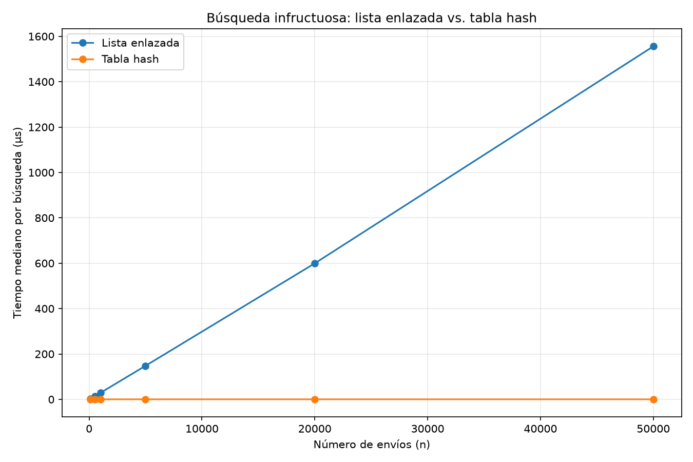
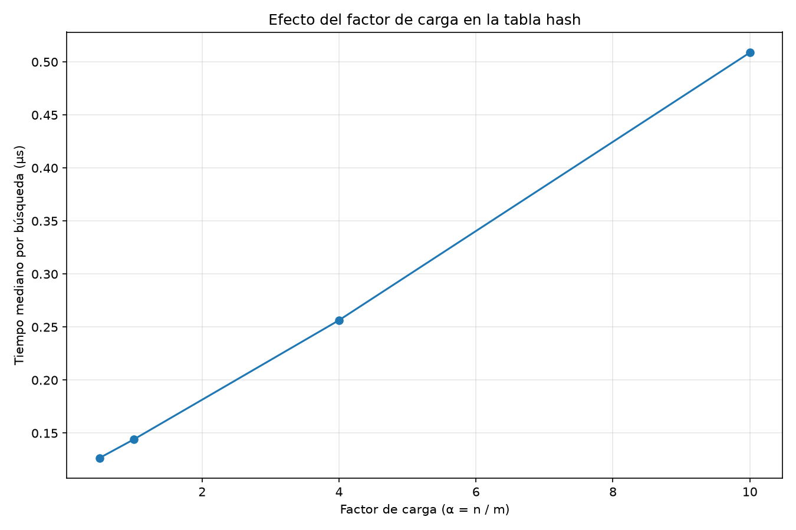

# Laboratorio de Tabla Hash — Rutas del Caribe

**Estudiante:** Alan Arias Ruiz

---

## Reproducción del proyecto

El proyecto implementa y compara dos estructuras para almacenar y buscar envíos de una empresa ficticia de mensajería: una **lista enlazada** y una **tabla hash**.

La estructura del proyecto es:

```text
lab3-estructuras-datos/
├── estructuras.py
├── pruebas.py
├── medicion.py
├── README.md
└── graficas/
    ├── lista_vs_tabla.png
    └── tiempo_vs_alfa.png
```

### 1. Crear el entorno virtual

En Windows:

```bash
python -m venv .venv
.venv\Scripts\activate
```

En Linux o macOS:

```bash
python3 -m venv .venv
source .venv/bin/activate
```

### 2. Instalar las dependencias

```bash
pip install matplotlib
```

### 3. Ejecutar las pruebas

```bash
python pruebas.py
```

Al finalizar correctamente, debe aparecer:

```text
Todas las pruebas finalizaron correctamente.
```

### 4. Ejecutar las mediciones

```bash
python medicion.py
```

El programa realiza las mediciones de rendimiento y genera las siguientes imágenes dentro de la carpeta `graficas/`:

- `graficas/lista_vs_tabla.png`
- `graficas/tiempo_vs_alfa.png`

---

# Parte 1 — Implementación y pruebas

**Código de las estructuras:** [estructuras.py](estructuras.py)

**Código de las pruebas:** [pruebas.py](pruebas.py)

La implementación contiene dos estructuras principales para almacenar pares `clave-valor`: una lista enlazada y una tabla hash.

## Lista enlazada

La clase `Nodo` representa cada elemento de la lista. Cada nodo contiene:

- una clave entera;
- un valor de tipo texto;
- una referencia al siguiente nodo.

La clase `ListaEnlazada` mantiene una referencia a su cabeza y un contador de elementos.

La operación `insertar` primero recorre la lista para comprobar si la clave ya existe. Si encuentra la clave, actualiza su valor. Si no la encuentra, crea un nuevo nodo y lo coloca al inicio de la lista.

Por esta razón, aunque insertar físicamente al inicio cuesta tiempo constante, la operación completa puede necesitar recorrer la lista para comprobar duplicados.

La operación `buscar` recorre los nodos desde la cabeza hasta encontrar la clave solicitada o llegar al final de la estructura.

## Tabla hash

La clase `TablaHash` utiliza un arreglo de cubetas. Cada cubeta contiene una instancia de `ListaEnlazada`.

La posición de una clave se obtiene mediante el método de división:

```text
indice = clave % capacidad
```

Cuando dos claves producen el mismo índice se produce una **colisión**. Las colisiones se resuelven mediante listas enlazadas dentro de cada cubeta.

La tabla también mantiene el número total de elementos almacenados, lo que permite calcular el factor de carga mediante:

```text
alpha = n / m
```

donde:

- `n` es el número de elementos almacenados;
- `m` es la cantidad de cubetas;
- `alpha` es el factor de carga.

## Verificación realizada

Las pruebas verifican tanto el funcionamiento individual de las estructuras como diferentes situaciones de búsqueda.

Se comprobaron:

1. La creación y funcionamiento de los nodos.
2. La inserción de elementos en una lista enlazada.
3. La búsqueda exitosa en una lista.
4. La búsqueda de claves inexistentes.
5. La actualización de valores cuando se inserta una clave que ya existe.
6. La inserción y búsqueda en la tabla hash.
7. El cálculo del factor de carga.
8. La longitud de los cajones.
9. La generación de colisiones controladas.
10. Colecciones aleatorias para comprobar el comportamiento de las estructuras en diferentes distribuciones de claves.

Para verificar explícitamente el manejo de colisiones se utilizó una tabla con `m = 7` y las claves:

```text
10, 24, 17
```

Las tres claves producen el mismo índice:

```text
10 % 7 = 3
24 % 7 = 3
17 % 7 = 3
```

Por tanto, las tres terminan almacenadas en la misma cubeta. Esto permite comprobar que la tabla hash no pierde elementos cuando ocurren colisiones y que la búsqueda puede recorrer correctamente la lista enlazada asociada a dicha cubeta.

Además, se utilizaron **25 colecciones aleatorias** para comprobar el comportamiento general de las estructuras y realizar búsquedas tanto exitosas como no exitosas.

Las pruebas no utilizan `dict`, `set` ni `hash()` para implementar las estructuras principales. La tabla hash se construye explícitamente mediante un arreglo de listas enlazadas y la función de dispersión basada en el método de división.

---

# Parte 2 — Medición experimental

**Código de medición:** [medicion.py](medicion.py)

La medición compara el tiempo de búsqueda de una lista enlazada frente a una tabla hash y estudia además el efecto del factor de carga sobre el rendimiento de la tabla.

Para medir el tiempo se utiliza `time.perf_counter()`, adecuado para medir intervalos pequeños de ejecución.

Cada medición realiza **200 búsquedas no exitosas**.

Para disminuir la influencia de variaciones puntuales del sistema, cada configuración se ejecuta **7 veces** y se utiliza la **mediana** de los tiempos obtenidos como resultado representativo.

## Experimento A — Crecimiento con respecto a `n`

En el primer experimento se varía la cantidad de elementos almacenados.

Se utilizaron los siguientes tamaños:

```text
n = 100
n = 500
n = 1000
n = 5000
n = 20000
n = 50000
```

Para la tabla hash se seleccionó un número primo de cubetas cercano a `n / 2`. De esta manera, el factor de carga se mantiene aproximadamente alrededor de:

```text
alpha = 2
```

Los parámetros utilizados fueron:

| `n` | `m` | Factor de carga aproximado |
|---:|---:|---:|
| 100 | 53 | 1.89 |
| 500 | 251 | 1.99 |
| 1000 | 503 | 1.99 |
| 5000 | 2503 | 2.00 |
| 20000 | 10007 | 2.00 |
| 50000 | 25007 | 2.00 |

Aquí `m` representa la cantidad de cubetas de la tabla hash.

### Resultados gráficos

La siguiente gráfica compara el tiempo de búsqueda de la lista enlazada y la tabla hash:



La lista enlazada presenta un crecimiento aproximadamente lineal con respecto a `n`, porque una búsqueda no exitosa puede obligar a recorrer todos sus elementos.

En cambio, la tabla hash mantiene un comportamiento mucho más estable cuando el factor de carga se conserva aproximadamente constante. Aunque existen colisiones, cada búsqueda solamente necesita recorrer el cajón correspondiente.

La diferencia se vuelve más evidente a medida que aumenta el número de elementos. Esto es consistente con las complejidades teóricas:

```text
Lista enlazada:
búsqueda promedio/favorable: O(n)

Tabla hash:
búsqueda esperada: O(1)
```

En el peor caso, una tabla hash puede llegar a comportarse como una lista enlazada si muchas claves terminan en la misma cubeta:

```text
Tabla hash, peor caso: O(n)
```

Por ello, el factor de carga y la distribución de las claves son importantes para el rendimiento.

---

## Experimento B — Influencia del factor de carga

En el segundo experimento se mantuvo constante:

```text
n = 20000
```

y se modificó el número de cubetas para obtener diferentes factores de carga.

Se realizaron mediciones para valores cercanos a:

```text
alpha = 0.5
alpha = 1
alpha = 4
alpha = 10
```

Los resultados obtenidos fueron:

| Factor de carga objetivo | `m` | Factor de carga real | Tiempo mediano |
|---:|---:|---:|---:|
| 0.5 | 40009 | 0.500 | 0.127 μs |
| 1 | 19997 | 1.000 | 0.144 μs |
| 4 | 4999 | 4.001 | 0.256 μs |
| 10 | 1999 | 10.005 | 0.509 μs |

La gráfica correspondiente es:



Los resultados muestran una relación clara entre el factor de carga y el tiempo de búsqueda.

Con `alpha = 0.5`, el tiempo mediano fue de `0.127 μs`. Al aumentar el factor de carga hasta aproximadamente `10`, el tiempo aumentó hasta `0.509 μs`.

Por tanto, en estas mediciones el tiempo pasó aproximadamente de `0.127 μs` a `0.509 μs`, es decir, cerca de cuatro veces el valor inicial.

Esto ocurre porque aumentar `alpha` significa almacenar más elementos por cubeta en promedio. Como consecuencia, las listas utilizadas para resolver las colisiones tienden a ser más largas y las búsquedas requieren recorrer más nodos.

Los resultados experimentales permiten observar que la tabla hash no solamente depende de la cantidad total de elementos `n`, sino también de la relación entre `n` y `m`.

---

# Parte 3 — Análisis

## 1. ¿Cuál es el costo teórico de buscar en una lista enlazada y en una tabla hash?

En una lista enlazada, la búsqueda se realiza secuencialmente. En el peor caso es necesario revisar todos los elementos.

Por tanto:

```text
Lista enlazada:
mejor caso: O(1)
promedio: O(n)
peor caso: O(n)
```

En una tabla hash, primero se calcula la posición correspondiente a la clave mediante la función hash y después se busca dentro del cajón.

Si la distribución de las claves es adecuada y el factor de carga se mantiene controlado, el costo esperado es:

```text
Tabla hash:
esperado: O(1)
```

Sin embargo, si se producen muchas colisiones, el cajón puede contener una cantidad considerable de elementos. En el peor caso, todos los elementos podrían terminar en la misma cubeta y la búsqueda tendría costo:

```text
peor caso: O(n)
```

Por esta razón, `O(1)` para una tabla hash debe interpretarse como un costo esperado bajo una distribución adecuada de las claves, no como una garantía absoluta para todos los casos.

---

## 2. ¿Los resultados experimentales coinciden con el comportamiento teórico?

Sí.

La lista enlazada presenta un crecimiento asociado directamente con `n`. Para una búsqueda no exitosa, la estructura debe recorrer todos los nodos antes de determinar que la clave no está presente.

La tabla hash, en cambio, distribuye los elementos entre diferentes cubetas. En el Experimento A se mantuvo el factor de carga aproximadamente constante alrededor de `alpha = 2`.

Esto permite que el costo de las búsquedas permanezca mucho más estable al aumentar `n`.

El Experimento B proporciona una evidencia adicional. Manteniendo `n = 20000`, el tiempo mediano aumentó conforme aumentó `alpha`:

| `alpha` | Tiempo |
|---:|---:|
| 0.5 | 0.127 μs |
| 1 | 0.144 μs |
| 4 | 0.256 μs |
| 10 | 0.509 μs |

Por ejemplo, al comparar `alpha = 0.5` con `alpha = 10`, el tiempo pasó de `0.127 μs` a `0.509 μs`.

Esto demuestra experimentalmente que una tabla hash puede mantener un comportamiento cercano al esperado `O(1)` cuando las colisiones se encuentran controladas, mientras que un aumento importante del factor de carga incrementa el trabajo necesario para resolver las colisiones.

---

## 3. ¿Cómo afectan las colisiones al rendimiento de la tabla hash?

Las colisiones hacen que varias claves tengan que almacenarse dentro de la misma cubeta.

En esta implementación se utiliza una lista enlazada para resolverlas. Por ejemplo, con `m = 7`:

```text
10 % 7 = 3
24 % 7 = 3
17 % 7 = 3
```

Por tanto, las tres claves se almacenan en el cajón `3`.

Cuando se busca una de ellas, primero se calcula el índice `3` y después se recorre la lista enlazada de ese cajón.

Mientras más elementos se concentren en una misma cubeta, más larga será la búsqueda dentro de ella.

Esto se observa en el Experimento B. Con `n = 20000`, aumentar el factor de carga produjo los siguientes resultados:

```text
alpha = 0.5  -> 0.127 μs
alpha = 1    -> 0.144 μs
alpha = 4    -> 0.256 μs
alpha = 10   -> 0.509 μs
```

Por tanto, las colisiones no hacen que la tabla deje de funcionar, pero sí pueden aumentar el tiempo de búsqueda.

Una buena distribución de las claves y una cantidad adecuada de cubetas permiten reducir este efecto.

---

## 4. ¿Por qué utilizar una tabla hash en lugar de un árbol binario de búsqueda balanceado?

La principal ventaja de la tabla hash para este problema es el costo esperado de búsqueda.

Una tabla hash correctamente dimensionada ofrece:

```text
Búsqueda esperada: O(1)
```

Mientras que un árbol binario de búsqueda balanceado ofrece:

```text
Búsqueda: O(log n)
```

Por lo tanto, si la operación principal del sistema consiste en localizar un envío a partir de una clave exacta, la tabla hash puede ser una alternativa más rápida.

Sin embargo, el árbol balanceado tiene una ventaja importante: mantiene los elementos ordenados.

Esto permite realizar operaciones relacionadas con rangos o sucesores de manera eficiente. Por ejemplo, si se quisiera consultar todos los envíos cuyas claves estuvieran entre dos valores, un árbol balanceado sería más apropiado.

Una tabla hash está diseñada principalmente para búsquedas exactas por clave.

Por tanto:

| Necesidad | Estructura conveniente |
|---|---|
| Buscar una clave exacta | Tabla hash |
| Insertar/buscar por clave exacta | Tabla hash |
| Mantener elementos ordenados | Árbol balanceado |
| Consultar rangos de claves | Árbol balanceado |
| Encontrar sucesor/predecesor | Árbol balanceado |

La elección depende entonces de las operaciones que el sistema necesite realizar y no únicamente de cuál estructura tenga la menor complejidad para una operación individual.

---

## 5. La empresa debe almacenar 5.000.000 de envíos. ¿Qué configuración sería conveniente?

Si se mantiene aproximadamente el mismo criterio utilizado en el Experimento A, es decir, un factor de carga cercano a:

```text
alpha = 2
```

entonces:

```text
alpha = n / m
```

Despejando `m`:

```text
m = n / alpha
```

Para:

```text
n = 5.000.000
alpha = 2
```

se obtiene:

```text
m = 5.000.000 / 2
m = 2.500.000
```

Por tanto, sería razonable utilizar aproximadamente **2.500.000 cubetas**, ajustando posteriormente `m` a un valor adecuado para la implementación de la función hash.

La ventaja de esta configuración es que se mantiene una cantidad promedio de aproximadamente dos elementos por cubeta, siguiendo el criterio experimental utilizado anteriormente.

### ¿Qué ocurriría si solamente se utilizaran 200.000 cubetas?

En ese caso:

```text
n = 5.000.000
m = 200.000
```

y el factor de carga sería:

```text
alpha = 5.000.000 / 200.